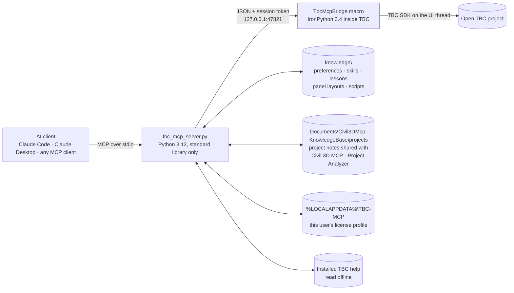

<div align="center">

# TBC MCP

**Talk to Trimble Business Center. Let your AI do the clicking.**

An MCP server for Trimble Business Center 2026 that reads your live project, runs real TBC commands, fills in
their panels the way you would, and keeps getting smarter with every session.

[](https://www.python.org/)
[](https://ironpython.net/)
[](https://geospatial.trimble.com/)
[](https://modelcontextprotocol.io/)
[](#what-you-need)
[](LICENSE)

[Highlights](#highlights) •
[How it works](#how-it-works) •
[Install](#how-to-install) •
[Use](#how-to-use) •
[Tools](#tool-catalog) •
[Safety](#built-in-safety) •
[Knowledge base](#a-knowledge-base-that-grows) •
[Versions](#tbc-versions) •
[Coverage](#tested-tab-by-tab) •
[Troubleshooting](#troubleshooting)

</div>

---

## Highlights

- **Your live project, not an export.** The AI reads points, linework, layers and surfaces from whatever is open in
  TBC right now, and its changes show up in the Plan View straight away.
- **Real TBC commands.** It opens the same command panels you use, types point IDs into coordinate boxes, picks
  objects, ticks grid checkboxes and presses Apply. No new geometry engine, just TBC doing what TBC does best.
- **It sees what you see.** "Put a grid where I'm looking" works: the AI can read the visible area of the Plan View
  and take a screenshot of TBC (and only TBC).
- **Remembers how you like to work.** Your preferences (numeric point IDs, feature codes in the Feature code box,
  tidy up when finished) are handed to every AI that connects, in every new chat.
- **Learns as it goes.** Verified recipes, gotchas and panel layouts are saved to a knowledge base, so the next
  session starts where the last one finished.
- **One project knowledge base for the whole suite.** What it learns about a job is kept in the same project notes
  that [Civil 3D MCP](https://github.com/michaelwachter20/civil3d-mcp-unified) and Project Analyzer use, so facts
  found in Civil 3D or in the job's documents come back in TBC, and the other way round.
- **Knows your license.** Every user's subscription is different. The server builds a license profile each time it
  starts and quietly skips commands you aren't licensed for, without a single license popup.
- **Polite by design.** Paced command launches, waits for Compute Project, never cancels a progress bar, and backs out
  of popups instead of guessing.
- **Zero install fuss.** Pure Python standard library on the outside, one macro file on the inside.
- **A status light on the ribbon.** The MCP Bridge button glows green while the bridge is running and red when it's off.

---

## How it works

TBC doesn't ship a general automation API for outside programs, so TBC MCP runs a small **macro inside TBC** that
opens a private, token-protected socket on your own machine. The MCP server talks to that bridge and speaks the
Model Context Protocol to your AI client.



- Work runs on TBC's own UI thread at background priority, so the bridge stays out of TBC's way.
- API edits are single undo steps, so **Ctrl+Z in TBC** reverses them.
- The panel engine (`mcp_server\ipy\*.py`) is sent to TBC with each call, so improvements apply instantly without
  reinstalling the macro.
- When TBC closes or crashes, the server notices and shuts itself down. No orphaned processes.

---

## How to install

About 10 minutes, once per computer.

### What you need

| What | Version |
|---|---|
| Windows | 10 or 11, with admin rights for one step |
| Trimble Business Center | **2026.10** (v44); other releases may need new knowledge, see [TBC versions](#tbc-versions) |
| Python | **3.12** ([python.org](https://www.python.org/downloads/), tick "Add python.exe to PATH" and keep the "py launcher") |
| An MCP client | [Claude Code](https://claude.com/claude-code), Claude Desktop, or any other MCP-capable AI app |

No extra Python packages are needed.

### Step 1 - Download

Go to this repository's **Releases** page (right-hand side on GitHub) and download the latest
`tbc-mcp-vX.Y.Z.zip`. Unzip it somewhere permanent, for example `C:\Tools\tbc-mcp`. (Avoid the Downloads folder:
the AI client will run the server from wherever you put it.)

Prefer git? `git clone` the repository instead; everything below is the same.

### Step 2 - Check Python

Open PowerShell and run:

```powershell
py -3.12 --version
```

It should print `Python 3.12.x`. If it doesn't, install Python 3.12 from python.org (newer versions such as 3.15
had problems).

### Step 3 - Install the bridge macro into TBC

In the unzipped folder, right-click empty space > **Open in Terminal** (or open PowerShell there) and run:

```powershell
powershell -ExecutionPolicy Bypass -File install_macro.ps1
```

Windows asks for administrator permission: this copies one file to `C:\ProgramData\Trimble\MacroCommands3\MCP`,
which normal users can't write to. **Restart TBC** afterwards. To remove it later, run the same command with
`-Uninstall` on the end.

### Step 4 - Connect your AI app

**Claude Code** (one command, use your own folder path):

```bash
claude mcp add tbc -- py -3.12 "C:\Tools\tbc-mcp\mcp_server\tbc_mcp_server.py"
```

**Claude Desktop:** open Settings > Developer > Edit Config, and add the `tbc` entry from `mcp_config_example.json`
to `claude_desktop_config.json`, with the path changed to your folder. Restart Claude Desktop.

**Other MCP apps:** register a stdio server whose command is `py` with arguments
`-3.12 <your folder>\mcp_server\tbc_mcp_server.py`.

### Step 5 - Switch on the bridge and check

1. Open TBC and a project (use a copy of a project the first time).
2. Click **Macros > MCP > MCP Bridge**. The button turns green: **MCP Bridge ON**.

| Light | Meaning |
|---|---|
| 🟢 **MCP Bridge ON** | bridge running, AI can connect |
| 🔴 **MCP Bridge OFF** | stopped (click to start) |

3. In your AI app, ask: *"Run bridge_status."* You should see the bridge version, your TBC release and build
   (e.g. 2026.10 / 44.0.9666.28609) and a summary of your license.

That's it. The light is checked against the real bridge, so green really means connected; it resets itself when
TBC restarts.

### Updating

Download the new release and unzip it over the old folder (your `knowledge\` additions are in that folder, so copy
it aside first if you changed it). Re-run `install_macro.ps1` only when the release notes say the macro changed.

---

## How to use

### The routine

1. Open TBC and your project, click **MCP Bridge** (green).
2. Talk to your AI in plain language. It reads the project, runs TBC commands, fills in panels and checks the result.
3. When you're done, click **MCP Bridge** again (red) or just close TBC - the AI server shuts itself down with TBC.

The first time in each chat the AI reads its operating rules (`working_safely_in_tbc`) and your license summary, so
it knows what it may do and which commands your license includes.

### Things to ask

**Look things up**
> "What's in this project? Count points, linestrings and surfaces by layer."
> "Zoom to the whole project and show me a screenshot."
> "What's the surface elevation at the point I'm looking at?"

**Make and change things**
> "Make a 20 by 20 grid of points at 25 ft spacing where I'm looking, code them GRID, and build a surface from them."
> "Offset the curb line 10 feet to the left on a new layer called OFFSET."
> "Split this lot into two equal halves parallel to its front line."
> "Move every point coded TOE onto a layer called TOE."

**Select**
> "Select all points coded TOE inside this boundary with elevations between 5 and 8."

**Check and report**
> "Find everywhere the breaklines cross at different elevations."
> "Which Linework commands can my license run?"

**Import and export**
> "Export the selected points as a P,N,E,elev,Code CSV to C:\Jobs\out.csv."
> "Import the CSV files in C:\Jobs\incoming." (it shows you what TBC will do with each file and asks first)

### Good habits

- **Save first, or work on a copy**, before big project-wide changes. Every change the AI makes through the API is
  one undo step (Ctrl+Z in TBC).
- **Tell it your preferences once** ("always use numeric point IDs", "put descriptions in the feature code") - they
  are saved and given to every AI in every future chat. Ask *"list my preferences"* to see them.
- **Let it finish.** While TBC is computing, the AI waits; don't cancel progress windows.
- **Some steps need you.** A few commands only accept clicks in the Plan View (Fillet, Capture Outline, Angular
  Dimension, Insert Image ...). The AI will say so; do that click and it carries on.
- **Things it won't do on its own:** print, use online services (Connected Workspace, RTX, internet downloads),
  press buttons on license popups, or delete import records.
- **If TBC crashes**, restart it and switch the bridge on again; tell the AI and it carries on. It logs crashes and
  looks for causes on its side.

### When it learns something

After a task the AI offers to record what it learned, and saves it once you agree. Panel layouts are recorded
automatically. It keeps two kinds of knowledge apart:

- **How TBC works** (recipes, gotchas, the layout of panels it opened) goes in `knowledge\`. It's general, so it
  never names a job, point IDs, coordinates or layers. The next chat, or a colleague's AI using the same folder,
  starts from there. Share the `knowledge\` folder (or this repository) to share it; your license profile stays on
  your own PC.
- **Facts about one job** (what its layers and point ranges are for, the control, the client's standards, your
  decisions) go in the job's [shared project notes](#shared-project-knowledge), which Civil 3D MCP and Project
  Analyzer read too.

---

## Tool catalog

Coordinates use the project's display units (x = easting, y = northing) unless you ask for meters. Objects are
identified by their integer `serial`.

<details open>
<summary><b>Project and data</b> (10 tools)</summary>

| Tool | What it does |
|---|---|
| `bridge_status` | connection, bridge version, TBC release/build and license summary |
| `project_info` | project name, file, display units, point and layer counts, unsaved-changes flag |
| `list_entities` | objects in the project, filterable by layer and type |
| `get_entity` | full details of one object, including linestring vertices and effective elevations |
| `list_points` | points with ID, coordinates, code and layer |
| `list_layers` | layers, optionally with object counts |
| `list_surfaces` | surfaces with vertex/triangle counts and elevation range |
| `surface_elevation` | elevation of a surface at a location |
| `get_selection` / `set_selection` | read or set what's selected in TBC |

</details>

<details>
<summary><b>Create and change</b> (6 tools)</summary>

| Tool | What it does |
|---|---|
| `create_points` | new points; numeric IDs by default, feature codes go in the Feature code box |
| `create_linestring` | a linestring from a list of vertices |
| `create_layer` | a new layer |
| `set_properties` | change name, layer and other properties |
| `delete_entities` | delete through TBC's own Delete command (layers too) |
| `save_project` | save the open project |

</details>

<details>
<summary><b>TBC commands and panels</b> (9 tools)</summary>

| Tool | What it does |
|---|---|
| `list_commands` | every TBC command (~1,180) with its license status |
| `run_command` | launch a command by key |
| `command_ui_open` | open a command panel and describe its fields and buttons |
| `command_ui_inspect` | re-read the open panel |
| `command_ui_fill` | fill fields: text, numbers, choices, checkboxes, radio buttons, coordinate boxes (point IDs), object pickers (serials), multi-select boxes (lists of serials) |
| `command_ui_click` | press a button or select a tab |
| `command_ui_close` | close the panel |
| `ui_grid` | read and edit tables, including Layer Manager and Infragistics grids |
| `tbc_dialogs` | read, answer or dismiss popups, including WPF popups and Windows file dialogs |

</details>

<details>
<summary><b>View and timing</b> (2 tools)</summary>

| Tool | What it does |
|---|---|
| `tbc_view` | visible area ("where I'm looking"), zoom to extents, screenshot of the TBC view |
| `tbc_wait_idle` | wait for Compute Project and other background work to finish |

</details>

<details>
<summary><b>Knowledge and help</b> (8 tools)</summary>

| Tool | What it does |
|---|---|
| `tbc_license` | license profile: features, expiry, which commands you can run |
| `tbc_preferences` | your standing rules; add, update or remove them |
| `tbc_project_notes` | the job's notes, shared with Civil 3D MCP and Project Analyzer; link folders, add notes, read the job's files and analysis reports |
| `tbc_skills` | search and read verified how-tos (skills, lessons, scripts, panel layouts) |
| `tbc_memory` | record and read lessons |
| `tbc_script` | save and run parameterised IronPython scripts |
| `tbc_help` | search and read TBC's installed help (~3,500 topics), offline |
| `search_sdk_docs` | search the Trimble Macros SDK reference |

</details>

<details>
<summary><b>Import and export</b> (2 tools)</summary>

| Tool | What it does |
|---|---|
| `tbc_export` | list every exporter by category, or export chosen objects to a file path (CSV, DXF, LandXML and ~110 more); never Remote Save |
| `tbc_import` | scan a folder (shows the importer TBC picked for each file), then import with `confirm=true`; handles TBC's Import Format Editor |

</details>

<details>
<summary><b>Power tool</b> (1 tool)</summary>

| Tool | What it does |
|---|---|
| `execute_python` | run IronPython inside TBC with the SDK loaded; turn off with `TBC_MCP_ALLOW_PYTHON=0` |

</details>

---

## Built-in safety

TBC is a big, busy application. These guardrails are built into the tools, so every AI gets them automatically:

| Guardrail | What it means for you |
|---|---|
| **License check first** | Unlicensed commands are declined up front, so TBC never throws a license popup at you. |
| **Ask before acting** | Commands that act immediately or open a web page need an explicit `confirm=true`, so the AI asks you first. |
| **Paced launches** | At least 2.5 s between commands, and a panel must finish loading before anything is typed into it. |
| **Waits for Compute Project** | Nothing happens while TBC is computing, and a progress window is never cancelled. |
| **Gentle with popups** | Only Cancel, Close or No are ever pressed automatically; otherwise the popup is closed with X. TBC error reports are logged and work stops. |
| **Field-order guards** | Panels that need one field before another (for example Divide Area's area before its baseline) are filled in a safe order. |
| **Settle time** | A short pause after each entry lets TBC finish drawing previews before the next step. |
| **Deletes the TBC way** | Deletion always goes through TBC's own Delete command, and never removes an import's record (that broke the next import). |
| **Version aware** | Knowledge carries the TBC release it was verified on; newer releases get added sections, nothing older is deleted. |
| **Privacy first** | Screenshots capture TBC only and are refused when another window covers it. |
| **Local only** | The bridge listens on 127.0.0.1 with a fresh token each session, and shuts down with TBC. |
| **Undo friendly** | API edits are single undo steps. |

---

## A knowledge base that grows

Everything the AI learns is written down in `knowledge\`, so the next session (or a different AI) starts out
experienced.

| Where | What lives there | Tool |
|---|---|---|
| `preferences.json` | your standing rules, **included in the instructions every AI receives** | `tbc_preferences` |
| `skills\**\*.skill.md` | step-by-step recipes verified against real projects; start with `basics\working_safely_in_tbc` | `tbc_skills` |
| `memory\lessons.jsonl` | gotchas and facts; the ones for a command pop up when it opens or when code uses it | `tbc_memory` |
| `commands\*.json` | the layout of every command panel opened so far | automatic |
| `scripts\*.py` | reusable, parameterised scripts | `tbc_script` |
| `memory\crash_log.md` | crash investigations on this machine (kept out of git) | - |
| `memory\tbc_errors.log` | TBC error popups the tools caught (kept out of git) | - |

**Today it holds** 7 preferences, 19 skills, 81 lessons, 109 recorded panel layouts and 2 scripts, all verified on TBC 2026.10.

The skills cover TBC basics and safe working, the CAD, Survey, Linework and Drafting tabs, Home's Import/Export and
Selection tools, command panel automation, Layer Manager, creating points, surfaces and reusable scripts.

It follows the same rules as Civil 3D MCP and Project Analyzer: **add, never delete**; small one-line entries with
ids; the same entry is never stored twice; files are written whole (temp file, then rename), so a crash never
leaves half a file; and the AI asks you before it saves anything.

### Shared project knowledge

TBC MCP, [Civil 3D MCP](https://github.com/michaelwachter20/civil3d-mcp-unified) and Project Analyzer work like a
suite: they share **one knowledge base per job**. All three follow one contract, `docs\shared-project-knowledge.md`
in the Project Analyzer repository; TBC's side is `mcp_server\projects.py`. It's plain files, in the folder Civil
3D MCP already uses:

```
Documents\Civil3DMcp-KnowledgeBase\     (or CIVIL3D_KNOWLEDGE_DIR)
  projects\<project>.json               the job: its name, linked folders and notes
  projects\<project>\                   the job's files: anything you drop in, and Project Analyzer's reports
    analysis\                           OVERVIEW, TIMELINE, PEOPLE, ISSUES, INDEX
      intel\                            ENTITIES, TIMELINE, THREADS, VERSIONS, AMOUNTS (automatic connections)
```

Only facts about a job are shared. TBC's preferences, lessons, skills, scripts and panel layouts stay in its own
`knowledge\` folder.

- **Matched by folder.** A job is linked to one or more folders. When the open `.vce` is inside one, its notes come
  back with `project_info` and the first command or code result of a chat. If the job already exists from Civil
  3D or the analyzer, link the TBC folder to that name and everything it knows is there.
- **Everyone reads everything.** Notes the Civil 3D assistant wrote, facts Project Analyzer found in the job's
  documents (each citing its source file), and notes TBC wrote all sit side by side. Each note's `source` says which
  tool wrote it: `tbc`, `project-analyzer`, or none for Civil 3D MCP.
- **Each tool changes only its own.** TBC updates or removes only notes marked `"source": "tbc"`, and unlinks only
  folders it linked (it lists them in its own field, `tbc_linked_folders`). Another tool's note is corrected by
  adding a new note, never by rewriting it.
- **Nothing else is touched.** The job file is read again right before every change, so TBC merges into whatever
  another tool just wrote. Fields TBC doesn't know about are kept exactly as they are. A file that doesn't parse is
  left alone.
- **Same reference formats everywhere**, so Project Analyzer can connect a TBC note to every document and drawing
  that mentions the same thing: `2026-10-03`, `12+50`, `MH-3`, `C-104`, `RFI 12`, `CO 4`, `$12,500.00`,
  `John Smith (J. Smith)`. Notes end with `[source: <TBC project or command>]` when there is one. A note written
  another way is still saved, with a reminder.
- **Analysis reports.** After Project Analyzer has read a job's documents, `analysis\` holds its overview, timeline,
  people and issues. `analysis\intel\ENTITIES.md` lists every person, organization, place, document number,
  structure, station and sheet, with the files each appears in, so *"what do the documents say about MH-3?"* works
  from TBC. `tbc_project_notes action=read` reads them.
- **Private stays private.** License details, the bridge's session token and paths inside your user profile are
  refused in notes, and per-user folders (AppData, temp) can't be linked.
- **Stays on this computer**, like your license profile. Point `CIVIL3D_KNOWLEDGE_DIR` at a shared drive to share
  jobs with a team. Set it the same for all three tools.

Ask *"what do we know about this job?"* to see a job's notes, or *"link this project to Elm Street Drainage"* to
join one Civil 3D or the analyzer already set up.

### Every user, every license

Each time the server starts it builds a fresh **license profile** in about half a second: your licensed features
with expiry dates, maintenance dates, and which of TBC's ~1,180 commands you can run. Commands are also checked
live before they run, and skill search flags recipes that rely on commands your license doesn't include, so a
knowledge base written on one machine is safe to share with another.

Your license details stay private. The profile is saved **only on your machine**, in
`%LOCALAPPDATA%\TBC-MCP\license\` (outside this repository). It is keyed by a one-way hash, never stores the raw
license key, names or emails, and is never written to the shared knowledge base.

---

## TBC versions

Everything in this repository (code, skills, lessons, recorded panel layouts, scripts, test results) was written
for and verified on **Trimble Business Center 2026.10 (build 44.0.9666.28609)**. Trimble changes panels between
releases, so the knowledge base is versioned, and the rule is simple: **add, never delete.**

| What | How it is versioned | When a newer release behaves differently |
|---|---|---|
| Running TBC | `bridge_status` reports `tbc.release` (from Windows' install record) and `tbc.build` (from the running program) | the AI is told the knowledge baseline differs |
| Skills | `tbc_versions` in the frontmatter + a banner under it | `tbc_skills action=append_version_section` adds a `## TBC <release>` section; overwriting a skill from another release is refused |
| Lessons | each lesson has `tbc_version` | add a new lesson; a lesson from another release cannot be deleted |
| Panel layouts | `tbc_version` per file | the new release's layout is stored under `versions` next to the original |
| Scripts | `script_version` (1, 2, 3 ...) + `tbc_versions` in the header | saving again bumps the version and archives the old file in `knowledge/scripts/_archive/`; retiring a script archives it too |
| Code and tests | a header comment naming the release | add handling for the new release; keep the 2026.10 path |

Search results and skill reads carry a `version_note` whenever the running TBC isn't a release the item was verified on.

---

## Tested tab by tab

Each ribbon tab is surveyed (every button opened, its panel recorded and its help read). The tools are then
**used for real** on throwaway objects, and the results are checked against the actual geometry.

| Tab | Surveyed | Verified in use | Notes |
|---|---|---|---|
| **CAD** | 44 / 44 | Move, Rotate, Scale, Mirror, Copy, Change Elevation, Relayer, Name, Explode, Create at Intervals, Drape, Create Surface | `cad_editing_tools` |
| **Survey** | 47 / 47 | most COGO, field data, optical and network tools | `survey_tools_usage`; a few need Plan View picks or project setup |
| **Linework** | 55 / 55 | **29 of 31 licensed tools** | `linework_tools_usage`; Capture Outline and Fillet/Chamfer need Plan View picks |
| **Drafting** | 47 / 47 | **22 tools**: text, dimensions, labels, label tables, leaders, blocks (create, insert, import, purge), hatch, quick profile, plotbox, plan/sheet sets, dynaview boundaries, scale bar, 3D PDF | `drafting_tools_usage`; style managers documented; Angular Dimension, Insert Image and sheet-view tools need the view; nothing is ever printed |
| **Home** | Import, Export, Selection | export to CSV, DXF, LandXML; import of CSV points and DXF linework; all 12 selection tools | `home_import_export`, `selection_tools`; never delete import records |
Run the Linework suite yourself (it cleans up after itself):

```bash
py -3.12 tests\linework_tests.py
```

---

## Configuration

All settings are optional environment variables.

| Variable | Default | Purpose |
|---|---|---|
| `TBC_MCP_ALLOW_PYTHON` | `1` | set to `0` to turn off `execute_python` |
| `TBC_MCP_EXIT_WITH_TBC` | `1` | shut the server down when TBC closes |
| `TBC_MCP_TIMEOUT` | `120` | seconds to wait for a bridge reply |
| `TBC_MCP_IDLE_TIMEOUT` | `900` | longest wait for Compute Project, in seconds |
| `TBC_MCP_COMMAND_GAP` | `2.5` | minimum seconds between command launches |
| `TBC_MCP_KNOWLEDGE_DIR` | `knowledge\` | use a different (e.g. shared) knowledge base |
| `CIVIL3D_KNOWLEDGE_DIR` | `Documents\Civil3DMcp-KnowledgeBase` | the project knowledge base shared with Civil 3D MCP and Project Analyzer (set it the same for all three) |
| `TBC_MCP_USER_DIR` | `%LOCALAPPDATA%\TBC-MCP` | private per-user folder for license profiles |
| `TBC_MCP_INFO` | `%TEMP%\tbc_mcp_bridge.json` | where the bridge publishes its port and token |
| `TBC_MCP_PORT` / `TBC_MCP_TOKEN` | from the info file | connect to a bridge manually |
| `TBC_HELP_DIR` | installed TBC help | location of TBC's HTML help |
| `TBC_SDK_DOCS` | `C:\Program Files (x86)\Trimble\Macros SDK` | location of the Macros SDK docs |

---

## Troubleshooting

**"TBC bridge is not running"**
- Open a project and click **Macros › MCP › MCP Bridge** until the light is green.

**The MCP Bridge button is missing**
- Run `install_macro.ps1` again (it needs admin), then restart TBC.

**A command is refused as unlicensed**
- That's the license check doing its job. `tbc_license` shows which feature the command needs.

**The AI asks before running a command**
- The command is known to act immediately or open a web page. Say yes if you want it.

**Python errors right at startup**
- Use Python 3.12 (`py -3.12`). Python 3.15 failed inside its own HTML parser.

**TBC crashed mid-task**
- TBC can be temperamental. Restart it, switch the bridge back on and carry on; the server reconnects. Crashes are
  noted in `knowledge\memory\crash_log.md` and investigated, so anything the MCP is doing wrong gets fixed.

**A tool says it needs a pick in the Plan View**
- A few commands (Capture Outline, Fillet/Chamfer, Angular Dimension, Insert Image, Legal Description) only accept
  clicks in the view. Do that step
  by hand and the AI picks up from there.

---

## Under the hood

| Path | What it is |
|---|---|
| `tbc_macro\TbcMcpBridge.py` | the bridge macro that runs inside TBC |
| `mcp_server\tbc_mcp_server.py` | the MCP server (38 tools) |
| `mcp_server\ipy\` | code sent into TBC on each call: panel engine, view, license, import/export |
| `mcp_server\knowledge.py`, `projects.py`, `tbc_help.py` | knowledge base, shared project knowledge and offline help reader |
| `tests\` | live usage suites on throwaway objects (`cad_edit_tests.py`, `survey_cogo_tests.py`, `linework_tests.py`, `drafting_tests.py`, `home_tests.py`, `selection_tests.py`), the ribbon-tab surveyor (`tab_survey.py` + `write_tab_skill.py`), smoke tests (`test_watchdog.py` and `test_project_knowledge.py` offline, `test_mcp_stdio.py`, `test_v2_e2e.py`) and shared helpers in `tbc_testkit.py` |
| `tests\tab_data\` | survey results per ribbon tab (every button, its panel and help), used to write the tab overview skills |
| `tests\dev\` | one-off development probes (`ui_dev.py`, `explore_command_ui.py`, IronPython checks, `run_ipy.ps1` to run TBC's IronPython outside TBC) |
| `tools\` | `reflect.ps1` (type signatures from TBC's DLLs) and `sdkdoc.py` (search the SDK docs) |

The Macros SDK reference is from an older TBC release. `tbc_help` reads the help installed with TBC 2026 and is the
more reliable guide.

---

## License

Released under the [MIT License](LICENSE). © 2026 Michael Wachter.

Trimble and Trimble Business Center are trademarks of Trimble Inc. This is an independent project and is not
affiliated with or endorsed by Trimble.
