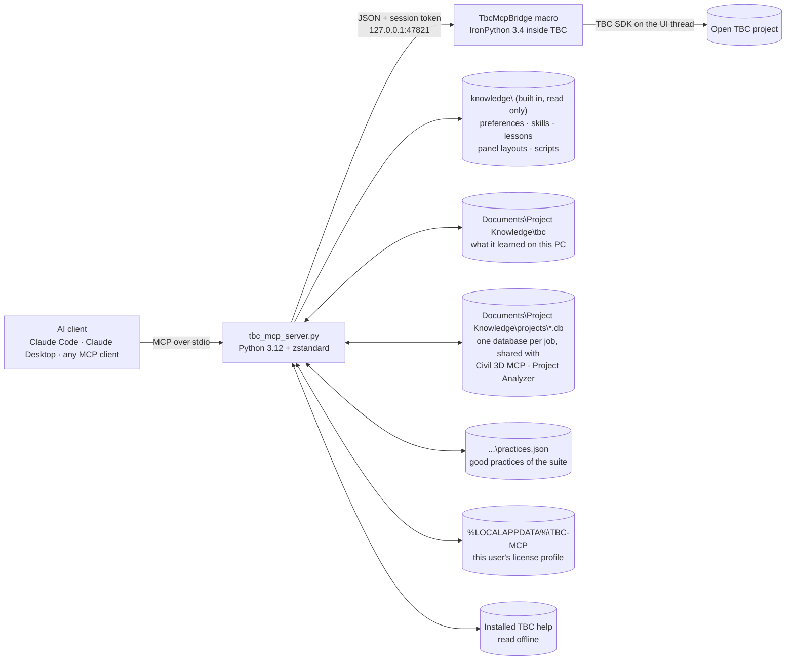

<div align="center">

# TBC MCP

**Talk to Trimble Business Center. Let your AI do the clicking.**

An MCP server for Trimble Business Center 2026 that reads your live project, runs real TBC commands, fills in
their panels the way you would, and keeps getting smarter with every session.

[](https://www.python.org/)
[](https://ironpython.net/)
[](https://geospatial.trimble.com/)
[](https://modelcontextprotocol.io/)
[](#what-you-need)
[](LICENSE)

[Highlights](#highlights) •
[How it works](#how-it-works) •
[Install](#how-to-install) •
[Use](#how-to-use) •
[Tools](#tool-catalog) •
[Safety](#built-in-safety) •
[Knowledge base](#a-knowledge-base-that-grows) •
[Versions](#tbc-versions) •
[Coverage](#tested-tab-by-tab) •
[Troubleshooting](#troubleshooting)

</div>

---

## Highlights

- **Your live project, not an export.** The AI reads points, linework, layers and surfaces from whatever is open in
  TBC right now, and its changes show up in the Plan View straight away.
- **Real TBC commands.** It opens the same command panels you use, types point IDs into coordinate boxes, picks
  objects, ticks grid checkboxes and presses Apply. No new geometry engine, just TBC doing what TBC does best.
- **It sees what you see.** "Put a grid where I'm looking" works: the AI can read the visible area of the Plan View
  and take a screenshot of TBC (and only TBC).
- **Remembers how you like to work.** Your preferences, and your company's practices (numeric point IDs, codes in
  the Feature code box), are handed to every AI that connects, in every new chat.
- **Learns as it goes.** Verified recipes, gotchas and panel layouts are saved on your PC, next to the built-in
  ones it ships with, so the next session starts where the last one finished.
- **One project database per job for the whole suite.** [Project Analyzer](https://github.com/michaelwachter20/project-analyzer)
  reads every document of a job into one database; TBC MCP and
  [Civil 3D MCP](https://github.com/michaelwachter20/civil3d-mcp-unified) search it, follow its facts and add what
  they learn, so facts found in Civil 3D or in the job's documents come back in TBC, and the
  other way round. TBC MCP doesn't need either of them: on its own it keeps the job's notes in the same database.
- **Your own documents for each job.** Put proposal guidelines, requirements for the building type, standards or
  code books in the job's **User Knowledge** folder; the AI follows them when they apply and says which one.
- **Knows your license.** Every user's subscription is different. The server builds a license profile each time it
  starts and quietly skips commands you aren't licensed for, without a single license popup.
- **Polite by design.** Paced command launches, waits for Compute Project, never cancels a progress bar, and backs out
  of popups instead of guessing.
- **Little install fuss.** Python's standard library plus one small package (`zstandard`) on the outside, one macro
  file on the inside.
- **A status light on the ribbon.** The MCP Bridge button glows green while the bridge is running and red when it's off.

---

## How it works

TBC doesn't ship a general automation API for outside programs, so TBC MCP runs a small **macro inside TBC** that
opens a private, token-protected socket on your own machine. The MCP server talks to that bridge and speaks the
Model Context Protocol to your AI client.



- Work runs on TBC's own UI thread at background priority, so the bridge stays out of TBC's way.
- API edits are single undo steps, so **Ctrl+Z in TBC** reverses them.
- The panel engine (`mcp_server\ipy\*.py`) is sent to TBC with each call, so improvements apply instantly without
  reinstalling the macro.
- When TBC closes or crashes, the server notices and shuts itself down. No orphaned processes.

---

## How to install

About 10 minutes, once per computer.

### What you need

| What | Version |
|---|---|
| Windows | 10 or 11, with admin rights for one step |
| Trimble Business Center | **2026.10** (v44); other releases may need new knowledge, see [TBC versions](#tbc-versions) |
| Python | **3.12** ([python.org](https://www.python.org/downloads/), tick "Add python.exe to PATH" and keep the "py launcher") |
| Python package | `zstandard` (reads the text stored in the project databases; installed in Step 2) |
| An MCP client | [Claude Code](https://claude.com/claude-code), Claude Desktop, or any other MCP-capable AI app |

### Step 1 - Download

Go to this repository's **Releases** page (right-hand side on GitHub) and download the latest
`tbc-mcp-vX.Y.Z.zip`. Unzip it somewhere permanent, for example `C:\Tools\tbc-mcp`. (Avoid the Downloads folder:
the AI client will run the server from wherever you put it.)

Prefer git? `git clone` the repository instead; everything below is the same.

### Step 2 - Check Python

Open PowerShell and run:

```powershell
py -3.12 --version
```

It should print `Python 3.12.x`. If it doesn't, install Python 3.12 from python.org (newer versions such as 3.15
had problems). Then install the one package it needs:

```powershell
py -3.12 -m pip install zstandard
```

Without it everything works except showing the text of a job's documents from the project database.

### Step 3 - Install the bridge macro into TBC

In the unzipped folder, right-click empty space > **Open in Terminal** (or open PowerShell there) and run:

```powershell
powershell -ExecutionPolicy Bypass -File install_macro.ps1
```

Windows asks for administrator permission: this copies one file to `C:\ProgramData\Trimble\MacroCommands3\MCP`,
which normal users can't write to. **Restart TBC** afterwards. To remove it later, run the same command with
`-Uninstall` on the end.

### Step 4 - Connect your AI app

**Claude Code** (one command, use your own folder path):

```bash
claude mcp add tbc -- py -3.12 "C:\Tools\tbc-mcp\mcp_server\tbc_mcp_server.py"
```

**Claude Desktop:** open Settings > Developer > Edit Config, and add the `tbc` entry from `mcp_config_example.json`
to `claude_desktop_config.json`, with the path changed to your folder. Restart Claude Desktop.

**Other MCP apps:** register a stdio server whose command is `py` with arguments
`-3.12 <your folder>\mcp_server\tbc_mcp_server.py`.

### Step 5 - Switch on the bridge and check

1. Open TBC and a project (use a copy of a project the first time).
2. Click **Macros > MCP > MCP Bridge**. The button turns green: **MCP Bridge ON**.

| Light | Meaning |
|---|---|
| 🟢 **MCP Bridge ON** | bridge running, AI can connect |
| 🔴 **MCP Bridge OFF** | stopped (click to start) |

3. In your AI app, ask: *"Run bridge_status."* You should see the bridge version, your TBC release and build
   (e.g. 2026.10 / 44.0.9666.28609) and a summary of your license.

That's it. The light is checked against the real bridge, so green really means connected; it resets itself when
TBC restarts.

### Updating

Download the new release and unzip it over the old folder. What the AI learned on your PC isn't in that folder (it
is in `Documents\Project Knowledge\tbc`), so nothing is lost. Re-run `install_macro.ps1` only when the
release notes say the macro changed.

Coming from 0.3: lessons, skills, scripts, panel notes and preferences the AI saved into the old folder's
`knowledge\` are not moved automatically. To keep them, copy what you added (for example new skill files, or your
own lines of `memory\lessons.jsonl`) into `Documents\Project Knowledge\tbc\` with the same layout. A job's
old notes file (`projects\<job>.json`) is moved into the job's database the first time any tool of the suite opens it.

---

## How to use

### The routine

1. Open TBC and your project, click **MCP Bridge** (green).
2. Talk to your AI in plain language. It reads the project, runs TBC commands, fills in panels and checks the result.
3. When you're done, click **MCP Bridge** again (red) or just close TBC - the AI server shuts itself down with TBC.

The first time in each chat the AI reads its operating rules (`working_safely_in_tbc`) and your license summary, so
it knows what it may do and which commands your license includes.

### Things to ask

**Look things up**
> "What's in this project? Count points, linestrings and surfaces by layer."
> "Zoom to the whole project and show me a screenshot."
> "What's the surface elevation at the point I'm looking at?"

**Make and change things**
> "Make a 20 by 20 grid of points at 25 ft spacing where I'm looking, code them GRID, and build a surface from them."
> "Offset the curb line 10 feet to the left on a new layer called OFFSET."
> "Split this lot into two equal halves parallel to its front line."
> "Move every point coded TOE onto a layer called TOE."

**Select**
> "Select all points coded TOE inside this boundary with elevations between 5 and 8."

**Check and report**
> "Find everywhere the breaklines cross at different elevations."
> "Which Linework commands can my license run?"

**Import and export**
> "Export the selected points as a P,N,E,elev,Code CSV to C:\Jobs\out.csv."
> "Import the CSV files in C:\Jobs\incoming." (it shows you what TBC will do with each file and asks first)

### Good habits

- **Save first, or work on a copy**, before big project-wide changes. Every change the AI makes through the API is
  one undo step (Ctrl+Z in TBC).
- **Tell it your preferences once** ("leave Layer Manager open", "don't use online tools") - they are saved and
  given to every AI in every future chat. Ask *"list my preferences"* to see them. Rules your company follows on
  every job, whatever the program ("point IDs are plain numbers, descriptions go in the feature code"), are
  **practices**: saved once, they're shared with Civil 3D MCP and Project Analyzer too. Ask *"list the practices"*.
- **Let it finish.** While TBC is computing, the AI waits; don't cancel progress windows.
- **Some steps need you.** A few commands only accept clicks in the Plan View (Fillet, Capture Outline, Angular
  Dimension, Insert Image ...). The AI will say so; do that click and it carries on.
- **Things it won't do on its own:** print, use online services (Connected Workspace, RTX, internet downloads),
  press buttons on license popups, or delete import records.
- **If TBC crashes**, restart it and switch the bridge on again; tell the AI and it carries on. It logs crashes and
  looks for causes on its side.

### When it learns something

After a task the AI offers to record what it learned, and saves it once you agree. Panel layouts are recorded
automatically. It keeps three kinds of knowledge apart, the same way as the rest of the suite:

- **How to drive TBC** (recipes, gotchas, the layout of panels it opened, your way of working) is TBC's own
  know-how. It's general, so it never names a job, point IDs, coordinates or layers. What ships with TBC MCP is in
  its `knowledge\` folder; what it learns on your PC is saved in `Documents\Project Knowledge\tbc`, never in
  this repository. The next chat starts from both.
- **Facts about one job** (what its layers and point ranges are for, the control, your decisions) go in the job's
  [project database](#shared-project-knowledge), which Civil 3D MCP and Project Analyzer read too.
- **Good practices** that hold on every job, whatever the program (*storm pipe minimum slope is 0.5%*, *label
  structures MH-n*) go in the suite's `practices.json`, which all three tools read.

---

## Tool catalog

Coordinates use the project's display units (x = easting, y = northing) unless you ask for meters. Objects are
identified by their integer `serial`.

<details open>
<summary><b>Project and data</b> (10 tools)</summary>

| Tool | What it does |
|---|---|
| `bridge_status` | connection, bridge version, TBC release/build and license summary |
| `project_info` | project name, file, display units, point and layer counts, unsaved-changes flag |
| `list_entities` | objects in the project, filterable by layer and type |
| `get_entity` | full details of one object, including linestring vertices and effective elevations |
| `list_points` | points with ID, coordinates, code and layer |
| `list_layers` | layers, optionally with object counts |
| `list_surfaces` | surfaces with vertex/triangle counts and elevation range |
| `surface_elevation` | elevation of a surface at a location |
| `get_selection` / `set_selection` | read or set what's selected in TBC |

</details>

<details>
<summary><b>Create and change</b> (6 tools)</summary>

| Tool | What it does |
|---|---|
| `create_points` | new points; numeric IDs by default, feature codes go in the Feature code box |
| `create_linestring` | a linestring from a list of vertices |
| `create_layer` | a new layer |
| `set_properties` | change name, layer and other properties |
| `delete_entities` | delete through TBC's own Delete command (layers too) |
| `save_project` | save the open project |

</details>

<details>
<summary><b>TBC commands and panels</b> (9 tools)</summary>

| Tool | What it does |
|---|---|
| `list_commands` | every TBC command (~1,180) with its license status |
| `run_command` | launch a command by key |
| `command_ui_open` | open a command panel and describe its fields and buttons |
| `command_ui_inspect` | re-read the open panel |
| `command_ui_fill` | fill fields: text, numbers, choices, checkboxes, radio buttons, coordinate boxes (point IDs), object pickers (serials), multi-select boxes (lists of serials) |
| `command_ui_click` | press a button or select a tab |
| `command_ui_close` | close the panel |
| `ui_grid` | read and edit tables, including Layer Manager and Infragistics grids |
| `tbc_dialogs` | read, answer or dismiss popups, including WPF popups and Windows file dialogs |

</details>

<details>
<summary><b>View and timing</b> (2 tools)</summary>

| Tool | What it does |
|---|---|
| `tbc_view` | visible area ("where I'm looking"), zoom to extents, screenshot of the TBC view |
| `tbc_wait_idle` | wait for Compute Project and other background work to finish |

</details>

<details>
<summary><b>Knowledge and help</b> (9 tools)</summary>

| Tool | What it does |
|---|---|
| `tbc_license` | license profile: features, expiry, which commands you can run |
| `tbc_preferences` | your standing rules; add, update or remove them |
| `tbc_project_notes` | the job's project database, shared with Civil 3D MCP and Project Analyzer: overview, search every document, a file, a person or structure (entity), timeline, the latest version of a file, problems to check, what changed; link folders, add facts, find a file's place in a copied job folder |
| `tbc_practices` | the suite's good practices (`practices.json`): list, search, add, update, remove |
| `tbc_skills` | search and read verified how-tos (skills, lessons, scripts, panel layouts) |
| `tbc_memory` | record and read lessons |
| `tbc_script` | save and run parameterised IronPython scripts |
| `tbc_help` | search and read TBC's installed help (~3,500 topics), offline |
| `search_sdk_docs` | search the Trimble Macros SDK reference |

</details>

<details>
<summary><b>Import and export</b> (2 tools)</summary>

| Tool | What it does |
|---|---|
| `tbc_export` | list every exporter by category, or export chosen objects to a file path (CSV, DXF, LandXML and ~110 more); never Remote Save |
| `tbc_import` | scan a folder (shows the importer TBC picked for each file), then import with `confirm=true`; handles TBC's Import Format Editor |

</details>

<details>
<summary><b>Power tool</b> (1 tool)</summary>

| Tool | What it does |
|---|---|
| `execute_python` | run IronPython inside TBC with the SDK loaded; turn off with `TBC_MCP_ALLOW_PYTHON=0` |

</details>

---

## Built-in safety

TBC is a big, busy application. These guardrails are built into the tools, so every AI gets them automatically:

| Guardrail | What it means for you |
|---|---|
| **License check first** | Unlicensed commands are declined up front, so TBC never throws a license popup at you. |
| **Ask before acting** | Commands that act immediately or open a web page need an explicit `confirm=true`, so the AI asks you first. |
| **Paced launches** | At least 2.5 s between commands, and a panel must finish loading before anything is typed into it. |
| **Waits for Compute Project** | Nothing happens while TBC is computing, and a progress window is never cancelled. |
| **Gentle with popups** | Only Cancel, Close or No are ever pressed automatically; otherwise the popup is closed with X. TBC error reports are logged and work stops. |
| **Field-order guards** | Panels that need one field before another (for example Divide Area's area before its baseline) are filled in a safe order. |
| **Settle time** | A short pause after each entry lets TBC finish drawing previews before the next step. |
| **Deletes the TBC way** | Deletion always goes through TBC's own Delete command, and never removes an import's record (that broke the next import). |
| **Version aware** | Knowledge carries the TBC release it was verified on; newer releases get added sections, nothing older is deleted. |
| **Privacy first** | Screenshots capture TBC only and are refused when another window covers it. |
| **Local only** | The bridge listens on 127.0.0.1 with a fresh token each session, and shuts down with TBC. |
| **Undo friendly** | API edits are single undo steps. |

---

## A knowledge base that grows

Everything the AI learns about driving TBC is written down, so the next session (or a different AI) starts out
experienced. It lives in two layers with the same layout:

- **Built in**: `knowledge\` in this repository, shipped with every release. Read only while TBC MCP runs.
- **Learned on this PC**: `Documents\Project Knowledge\tbc\` (or `TBC_MCP_KNOWLEDGE_DIR`). Everything the AI
  saves goes here, never into the repository, so nothing you or the AI learn reaches GitHub. Reads merge both, and
  the learned version wins: a skill or script of the same name, a command's panel record, or a lesson or preference
  you changed or removed. Saving over a built-in skill or script writes your own version here; the built-in file
  never changes.

| Where | What lives there | Tool |
|---|---|---|
| `preferences.json` | your standing rules, **included in the instructions every AI receives** | `tbc_preferences` |
| `skills\**\*.skill.md` | step-by-step recipes verified against real projects; start with `basics\working_safely_in_tbc` | `tbc_skills` |
| `memory\lessons.jsonl` | gotchas and facts; the ones for a command pop up when it opens or when code uses it | `tbc_memory` |
| `commands\*.json` | the layout of every command panel opened so far | automatic |
| `scripts\*.py` | reusable, parameterised scripts; old versions in `scripts\_archive\` | `tbc_script` |
| `memory\crash_log.md` | crash investigations on this machine (learned folder only) | - |
| `memory\tbc_errors.log` | TBC error popups the tools caught (learned folder only) | - |

**Built in today:** 5 preferences, 19 skills, 82 lessons, 117 recorded panel layouts and 2 scripts, all verified on TBC 2026.10. They're general TBC know-how only: nothing from one person's way of working or from a job.

The skills cover TBC basics and safe working, the CAD, Survey, Linework and Drafting tabs, Home's Import/Export and
Selection tools, command panel automation, Layer Manager, creating points, surfaces and reusable scripts.

It follows the same rules as Civil 3D MCP and Project Analyzer: **add, never delete**; small one-line entries with
ids; the same entry is never stored twice; files are written whole (temp file, then rename), so a crash never
leaves half a file; and the AI asks you before it saves anything. Two AI chats can save at the same time: each change
holds a lock file, so neither loses the other's. `preferences.json`, `lessons.jsonl` and the shared
`practices.json` keep their last 3 versions as `.bak1`..`.bak3` before they are rewritten, and a damaged line in
`lessons.jsonl` is skipped (and counted) instead of breaking the lessons.

### No job data in the repository

`knowledge\` is part of this repository and is shared with everyone who uses it, so it holds **general** TBC
know-how only, and so does the learned folder (it may be shared or built in later). Facts about a job go in the
[project database](#shared-project-knowledge), which lives outside every repository. This is checked, not just
asked for:

- **Before anything is saved** as a lesson, skill, skill section, script, command note or preference, the text is
  checked. It's refused, and the AI is told to use `tbc_project_notes action=add` instead, if it contains:
  - an absolute path outside the program and system folders (`C:\Program Files`, `C:\Program Files (x86)`,
    `C:\ProgramData` such as Trimble's GeoData folder, `C:\Windows`), or a network path;
  - a path in your user profile, the bridge's session token or a license detail;
  - the name of a job in the shared projects folder (its database or old notes file): its name, its slug, or the
    last folder name of its analysed folder or a linked folder. Matching is whole words, any case, and ignores names under 4 characters and generic folder names
    like Survey or Drawings;
  - a TBC project or job file name (`Elm.vce`, `CP.job`, `field.jxl`). An extension on its own (`.job`) and the
    SDK namespace `Trimble.Vce` are fine.
- **An audit test**, `tests\test_knowledge_audit.py`, scans every tracked file under `knowledge\` with the same
  rules, against the jobs this computer knows, and lists file and line for any hit.
- **`.gitignore` blocks job file types**: TBC and survey data, drawings, PDFs, Office files, email, archives, images,
  video and project databases (`*.db`, except the made-up test job in `tests\fixtures\`). A job file dropped into the repo by mistake is never committed. A file that really belongs can still
  be added with `git add -f`.

Panel layouts were already recorded without the entries of project-data dropdowns (layers, surfaces, styles ...).

### Shared project knowledge

TBC MCP, [Civil 3D MCP](https://github.com/michaelwachter20/civil3d-mcp-unified) and
[Project Analyzer](https://github.com/michaelwachter20/project-analyzer) work like a suite, with one contract: `docs\suite-knowledge.md` in the Project Analyzer repository (the exact table layout is its
`schema\project-db.sql`, shipped here as `mcp_server\project-db.sql`). TBC's side is `mcp_server\projects.py` and
`mcp_server\practices.py`. Project Analyzer is the project manager: it only reads a job folder and learns everything
in it. Civil 3D MCP and TBC MCP are the workers: they do the work using what it learned, and add what they find.

```
Documents\Project Knowledge\     (or PROJECT_KNOWLEDGE_DIR; an existing Civil3DMcp-KnowledgeBase keeps working)
  practices.json                        good practices, shared by all three tools
  projects\<job>.db                     one SQLite database per job
  projects\<job>\User Knowledge\        your own documents for the job (guidelines, requirements, standards)
  civil3d\                              what Civil 3D MCP learned on this PC
  tbc\                                  what TBC MCP learned on this PC (see above)
```

- **One database per job.** It holds every file of the job folder (details, references, and its text, compressed
  with zstd and indexed for search), what Project Analyzer worked out (people, places, structures, sheets, RFIs,
  events, stories, problems to check) and the **facts** every tool learned. No tool keeps copies of the job's files.
- **Matched by folder.** The open `.vce` belongs to the job whose folder contains it: the folder Project Analyzer
  read, or a folder a tool linked; the deepest one wins. A short overview (key facts, problems marked high, how many
  referenced files are missing) comes back with `project_info` and the first command or code result of a chat. If
  the job isn't known yet, the AI asks you which it is and links the TBC folder (`action=link`), creating the job's
  database when it's new.
- **What the AI can ask** (`tbc_project_notes`): `overview` (key and newest facts, open questions, rules, problems
  marked high, the people in most files, the practices), `search` (every word or code such as MH-3, 12+50, C-104 or
  RFI 12 in every document, plus the facts), `file` (one document: details, summary, references, facts citing it,
  its text), `entity` (a person, structure, sheet or RFI: its files, events and story), `timeline`, `latest` (the
  newest version of a file such as C-104, and the older ones, from Project Analyzer's version list; `near` picks a
  folder), `checks` (the problems Project Analyzer found to check, high first, filtered by severity or kind),
  `changes` (requirement changes the documents announce and files changed in the job folder, newest first, since a
  date or for one file), `list`, and `files` / `read` for the job's User Knowledge (below). *"What happened with RFI 12?"* and *"What do the
  documents say about MH-3?"* work from TBC.
- **User Knowledge, per job.** `Documents\Project Knowledge\projects\<job>\User Knowledge\` is for your own
  documents about how this job must be done: proposal guidelines, requirements for the building type, a client's
  standards, design manuals, code books (subfolders are fine). It's created the first time a tool opens the job, and
  no tool ever changes what's in it. The overview lists them, `read` opens one (`offset` continues a long one) and
  `search` covers them; the AI follows a document when it applies, names it, and tells you when it conflicts with
  a fact or the project. TBC MCP reads text files and Word, Excel and PowerPoint files itself. With Project
  Analyzer installed, every document there (PDFs and scans too) is read into the job's database, and TBC uses
  that text. Files that older versions kept directly in `projects\<job>\` are listed so you can move them in.
- **Each tool changes only its own.** TBC adds facts marked `tbc` (ids `fact-N`, taken inside the write
  transaction), updates them, and removes them by marking them retired (they stay, hidden; ids are never reused).
  Another tool's fact is corrected by adding one that supersedes it. TBC unlinks only folders it linked.
- **Safe together.** The database is shared with a long Project Analyzer run: WAL journal, short write
  transactions, a 10-second busy timeout and one retry; if it is still busy the AI is told to try again in a moment.
  Every read opens the database read only, so reading never changes it; only `link` and the note actions write. A
  database written by a newer version of a tool is only read. A damaged one is neither read nor written: the AI
  says so and how to put a backup back (`python analyze.py restore --project NAME` with Project Analyzer, else the
  newest copy in `projects\<job>.backups\`), and the job list still shows it, with a note.
- **Backups.** Before the first change of the day to a job database no Project Analyzer run looks after (one TBC
  created), TBC copies it to `projects\<job>.backups\<job> YYYY-MM-DD HHMMSS.db`, the same place and names
  Project Analyzer uses, checks the copy and keeps the newest 3.
- **Same reference formats everywhere**, so Project Analyzer can connect a TBC fact to every document and drawing
  that mentions the same thing: `2026-10-03`, `12+50`, `MH-3`, `C-104`, `RFI 12`, `CO 4`, `$12,500.00`,
  `John Smith (J. Smith)`. A fact's source (the open TBC project, or you) is recorded with it. A fact written another
  way is still saved, with a reminder.
- **Copied project folders.** A job folder is usually a copy of a project from another drive or a server. Files in
  it still point at the original location, and that includes a TBC project's imported files and linked images and
  data. So a missing path isn't necessarily gone, and an existing one isn't necessarily the right file.
  `tbc_project_notes action=locate path=<path as TBC shows it>` says where a file is in the copy: from the
  references Project Analyzer found in the job's files, then from where the job's files originally lived. It
  returns the status (found, found by name, ambiguous, missing, translated, not known), the full path, the path
  relative to the job folder, and for a missing file where it should be. When neither covers the path it says so,
  and the AI asks you where the original folder was instead of guessing. When TBC reports a missing file the AI runs
  `locate` first; when you relink a file in TBC, it offers to save that as a fact.
- **Old notes files.** Before the database, a job's notes were in `projects\<job>.json`. TBC reads them as they
  are; the first time a tool writes to the job it moves them into its database once (each note keeps its author and times) and renames the file
  `<job>.json.imported`.
- **Good practices** (`tbc_practices`): engineering and company practice for every job, in `practices.json`. All
  three tools read them, and the AI sees them at the start of every chat next to your preferences. TBC changes only
  the entries it added (`"source": "tbc"`), and asks you before adding one.
- **Private stays private.** License details, the bridge's session token and paths inside your user profile are
  refused in facts and practices, and per-user folders (AppData, temp) can't be linked.
- **Stays on this computer**, like your license profile. The databases must be on a local disk (SQLite can't be
  shared safely over a network folder); share a job with Project Analyzer's export and merge.

Ask *"what do we know about this job?"* for its overview, or *"link this project to Elm Street Drainage"* to join a
job Civil 3D or the analyzer already know.

**Works on its own, better together.** TBC MCP never needs Civil 3D MCP or Project Analyzer, and their versions don't
have to match: install any of them, in any order, and they share the folder above without any setup.

| Installed | What TBC MCP has |
|---|---|
| TBC MCP alone | TBC's tools and know-how; the job's notes, practices and User Knowledge (text, Word, Excel, PowerPoint) |
| + Project Analyzer | every document of the job folder and of User Knowledge (PDFs and scans too) searchable and readable, plus the people, timeline, problems to check and references it found |
| + Civil 3D MCP | the notes Civil 3D adds about the job, and shared practices |

### Every user, every license

Each time the server starts it builds a fresh **license profile** in about half a second: your licensed features
with expiry dates, maintenance dates, and which of TBC's ~1,180 commands you can run. Commands are also checked
live before they run, and skill search flags recipes that rely on commands your license doesn't include, so a
knowledge base written on one machine is safe to share with another.

Your license details stay private. The profile is saved **only on your machine**, in
`%LOCALAPPDATA%\TBC-MCP\license\` (outside this repository). It is keyed by a one-way hash, never stores the raw
license key, names or emails, and is never written to the shared knowledge base.

---

## TBC versions

Everything in this repository (code, skills, lessons, recorded panel layouts, scripts, test results) was written
for and verified on **Trimble Business Center 2026.10 (build 44.0.9666.28609)**. Trimble changes panels between
releases, so the knowledge base is versioned, and the rule is simple: **add, never delete.**

| What | How it is versioned | When a newer release behaves differently |
|---|---|---|
| Running TBC | `bridge_status` reports `tbc.release` (from Windows' install record) and `tbc.build` (from the running program) | the AI is told the knowledge baseline differs |
| Skills | `tbc_versions` in the frontmatter + a banner under it | `tbc_skills action=append_version_section` adds a `## TBC <release>` section; overwriting a skill from another release is refused |
| Lessons | each lesson has `tbc_version` | add a new lesson; a lesson from another release cannot be deleted |
| Panel layouts | `tbc_version` per file | the new release's layout is stored under `versions` next to the original |
| Scripts | `script_version` (1, 2, 3 ...) + `tbc_versions` in the header | saving again bumps the version and archives the old file in `scripts\_archive\` of the learned folder; retiring a script archives it too |
| Code and tests | a header comment naming the release | add handling for the new release; keep the 2026.10 path |

Search results and skill reads carry a `version_note` whenever the running TBC isn't a release the item was verified on.

---

## Tested tab by tab

Each ribbon tab is surveyed (every button opened, its panel recorded and its help read). The tools are then
**used for real** on throwaway objects, and the results are checked against the actual geometry.

| Tab | Surveyed | Verified in use | Notes |
|---|---|---|---|
| **CAD** | 44 / 44 | Move, Rotate, Scale, Mirror, Copy, Change Elevation, Relayer, Name, Explode, Create at Intervals, Drape, Create Surface | `cad_editing_tools` |
| **Survey** | 47 / 47 | most COGO, field data, optical and network tools | `survey_tools_usage`; a few need Plan View picks or project setup |
| **Linework** | 55 / 55 | **29 of 31 licensed tools** | `linework_tools_usage`; Capture Outline and Fillet/Chamfer need Plan View picks |
| **Drafting** | 47 / 47 | **22 tools**: text, dimensions, labels, label tables, leaders, blocks (create, insert, import, purge), hatch, quick profile, plotbox, plan/sheet sets, dynaview boundaries, scale bar, 3D PDF | `drafting_tools_usage`; style managers documented; Angular Dimension, Insert Image and sheet-view tools need the view; nothing is ever printed |
| **Home** | Import, Export, Selection | export to CSV, DXF, LandXML; import of CSV points and DXF linework; all 12 selection tools | `home_import_export`, `selection_tools`; never delete import records |
Run the Linework suite yourself (it cleans up after itself, and writes its results to
`tests\linework_results.json`):

```bash
py -3.12 tests\linework_tests.py
```

---

## Configuration

All settings are optional environment variables.

| Variable | Default | Purpose |
|---|---|---|
| `TBC_MCP_ALLOW_PYTHON` | `1` | set to `0` to turn off `execute_python` |
| `TBC_MCP_EXIT_WITH_TBC` | `1` | shut the server down when TBC closes |
| `TBC_MCP_TIMEOUT` | `120` | seconds to wait for a bridge reply |
| `TBC_MCP_IDLE_TIMEOUT` | `900` | longest wait for Compute Project, in seconds |
| `TBC_MCP_COMMAND_GAP` | `2.5` | minimum seconds between command launches |
| `TBC_MCP_KNOWLEDGE_DIR` | `<shared folder>\tbc` | where what the AI learns about driving TBC is saved (the built-ins in `knowledge\` are always read too) |
| `PROJECT_KNOWLEDGE_DIR` | `Documents\Project Knowledge` | the suite's shared folder (`CIVIL3D_KNOWLEDGE_DIR`, its earlier name, still works; an existing `Documents\Civil3DMcp-KnowledgeBase` is used as it is until you rename it to `Project Knowledge`): project databases, `practices.json` and (by default) TBC's learned know-how; set it the same for all three tools, on a local disk |
| `TBC_MCP_USER_DIR` | `%LOCALAPPDATA%\TBC-MCP` | private per-user folder for license profiles |
| `TBC_MCP_INFO` | `%TEMP%\tbc_mcp_bridge.json` | where the server looks for the bridge's port and token; for tests with a stand-in bridge only (the macro in TBC always writes to `%TEMP%`) |
| `TBC_MCP_PORT` / `TBC_MCP_TOKEN` | from the info file | connect to a bridge manually |
| `TBC_HELP_DIR` | installed TBC help | location of TBC's HTML help |
| `TBC_SDK_DOCS` | `C:\Program Files (x86)\Trimble\Macros SDK` | location of the Macros SDK docs |

---

## Troubleshooting

**"TBC bridge is not running"**
- Open a project and click **Macros › MCP › MCP Bridge** until the light is green.

**The MCP Bridge button is missing**
- Run `install_macro.ps1` again (it needs admin), then restart TBC.

**A command is refused as unlicensed**
- That's the license check doing its job. `tbc_license` shows which feature the command needs.

**The AI asks before running a command**
- The command is known to act immediately or open a web page. Say yes if you want it.

**Python errors right at startup**
- Use Python 3.12 (`py -3.12`). Python 3.15 failed inside its own HTML parser.

**"The zstandard package isn't installed"**
- Run `py -3.12 -m pip install zstandard` and restart your AI app. It's needed to show the text of a job's documents;
  without it `search` still lists the hits (without snippets) and `read` and `file` return everything but the stored
  text.

**"The job's database is busy"**
- Project Analyzer is writing to it (a long run commits every few seconds). Ask again in a moment.

**"The job's project database ... is damaged"**
- Close the tools using the job, then put a backup back: `python analyze.py restore --project "<job>"` with Project
  Analyzer installed, or copy the newest file from `Documents\Project Knowledge\projects\<job>.backups\` over
  `<job>.db` (keep the damaged file). TBC MCP never writes to a damaged database.

**TBC crashed mid-task**
- TBC can be temperamental. Restart it, switch the bridge back on and carry on; the server reconnects. Crashes are
  noted in `memory\crash_log.md` of the learned folder and investigated, so anything the MCP is doing wrong gets fixed.

**A tool says it needs a pick in the Plan View**
- A few commands (Capture Outline, Fillet/Chamfer, Angular Dimension, Insert Image, Legal Description) only accept
  clicks in the view. Do that step
  by hand and the AI picks up from there.

---

## Under the hood

| Path | What it is |
|---|---|
| `tbc_macro\TbcMcpBridge.py` | the bridge macro that runs inside TBC |
| [`docs\ARCHITECTURE.md`](docs/ARCHITECTURE.md) | how it all works inside: the pieces, the life of a tool call, the bridge, the safety layer, both knowledge bases, tests, release and known issues |
| [`CLAUDE.md`](CLAUDE.md) | the guide for whoever changes the code (AI or person): layout, checks, rules, adding a tool |
| `mcp_server\tbc_mcp_server.py` | the MCP server (39 tools) |
| `mcp_server\ipy\` | code sent into TBC on each call: panel engine, view, license, import/export |
| `mcp_server\knowledge.py`, `projects.py`, `practices.py`, `tbc_help.py` | TBC know-how (built-in + learned), the suite's project database, its good practices, and the offline help reader |
| `mcp_server\project-db.sql` | the project database's table layout, a copy of Project Analyzer's `schema\project-db.sql` |
| `tests\` | live usage suites on throwaway objects (`cad_edit_tests.py`, `survey_cogo_tests.py`, `linework_tests.py`, `drafting_tests.py`, `home_tests.py`, `selection_tests.py`), the ribbon-tab surveyor (`tab_survey.py` + `write_tab_skill.py`), smoke tests (`test_watchdog.py`, `test_project_knowledge.py`, `test_knowledge_split.py`, `test_knowledge_audit.py` and `test_server_fixes.py` offline, on the made-up job in `tests\fixtures\`, `test_mcp_stdio.py`, `test_v2_e2e.py`) and shared helpers in `tbc_testkit.py` |
| `tests\tab_data\` | survey results per ribbon tab (every button, its panel and help), used to write the tab overview skills |
| `tests\dev\` | one-off development probes (`ui_dev.py`, `explore_command_ui.py`, IronPython checks, `run_ipy.ps1` to run TBC's IronPython outside TBC) |
| `tools\` | `reflect.ps1` (type signatures from TBC's DLLs) and `sdkdoc.py` (search the SDK docs) |

The Macros SDK reference is from an older TBC release. `tbc_help` reads the help installed with TBC 2026 and is the
more reliable guide.

---

## License

Released under the [MIT License](LICENSE). © 2026 Michael Wachter.

Trimble and Trimble Business Center are trademarks of Trimble Inc. This is an independent project and is not
affiliated with or endorsed by Trimble.
