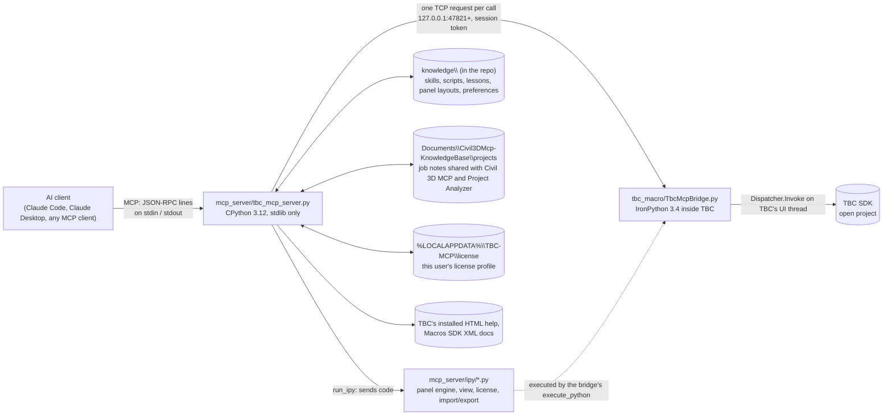

# TBC MCP architecture

How TBC MCP works inside, for anyone (AI or human) reading or changing the code. What it does for its users is
in [README.md](../README.md); the rules for changing it are in [CLAUDE.md](../CLAUDE.md). Every code file also opens
with a docstring or comment block describing it in detail; this page ties them together.

Everything here was written for and verified on **Trimble Business Center 2026.10 (build 44.0.9666.28609)**.

## 1. The pieces

| Piece | Runs in | Role |
|---|---|---|
| **MCP server** (`mcp_server/tbc_mcp_server.py`) | CPython 3.12, a process the AI client starts | Speaks MCP over stdio, holds the 38 tools, the safety layer and the AI's instructions; talks to the bridge |
| **Bridge macro** (`tbc_macro/TbcMcpBridge.py`) | IronPython 3.4 inside TBC | A TBC macro: the ribbon button (Macros > MCP > MCP Bridge) starts a token-protected socket server on 127.0.0.1 and runs requests on TBC's UI thread |
| **Inside-TBC modules** (`mcp_server/ipy/*.py`) | IronPython 3.4 inside TBC, sent per call | Larger pieces of TBC-side logic: the panel engine (`command_ui.py`), Plan View (`view.py`), license profile (`license.py`), Import/Export panes (`import_export.py`) |
| **General knowledge** (`mcp_server/knowledge.py` + `knowledge/`) | CPython | How TBC works: skills, saved scripts, lessons, recorded panel layouts, the user's preferences. Committed with the repo |
| **Shared project knowledge** (`mcp_server/projects.py`) | CPython | Facts about one job, shared with Civil 3D MCP and Project Analyzer through files outside the repo |
| **Help reader** (`mcp_server/tbc_help.py`) | CPython | Offline search and reading of TBC's installed HTML help |

## 2. Repository map

| Path | What it is |
|---|---|
| `mcp_server/tbc_mcp_server.py` | The server. Sections in file order: config from env vars; bridge client (`bridge_endpoint`, `call_bridge`, `run_ipy`); safety layer and command-panel tools; knowledge and object tools; help; Import/Export; license profile and TBC release detection; shared project knowledge; SDK doc search; the `TOOLS` table and `INSTRUCTIONS`; JSON-RPC loop (`handle`, `main`, `watch_tbc`) |
| `mcp_server/ipy/command_ui.py` | Panel engine: reads and fills TBC command panels, popups and docked panes (WinForms and WPF), clicks buttons, reads and edits grids |
| `mcp_server/ipy/view.py` | Active Plan View: visible extents, screen rectangle, screenshot, zoom |
| `mcp_server/ipy/license.py` | License fingerprint and profile (features, dates, which commands are licensed) |
| `mcp_server/ipy/import_export.py` | Drives TBC's Import (WPF) and Export (WinForms) panes; never presses Import or Export itself |
| `mcp_server/knowledge.py` | General knowledge store and the job-data guard (`check_general`) |
| `mcp_server/projects.py` | Shared project notes, files folder, Project Analyzer's reports, `locate` for copied folders, privacy checks |
| `mcp_server/tbc_help.py` | TBC help reader |
| `tbc_macro/TbcMcpBridge.py` | The bridge macro |
| `install_macro.ps1` | Copies the macro into `C:\ProgramData\Trimble\MacroCommands3\MCP` (asks for admin; `-Uninstall` removes it) |
| `knowledge/` | The general knowledge base (data): `skills/`, `scripts/`, `memory/lessons.jsonl`, `commands/*.json`, `preferences.json` |
| `tests/` | Offline tests (`test_project_knowledge.py`, `test_knowledge_audit.py`, `test_server_fixes.py`, `test_watchdog.py`), live suites per ribbon tab, the tab surveyor, smoke tests, shared helpers (`tbc_testkit.py`) |
| `tests/tab_data/` | Survey results per ribbon tab, used to write the tab overview skills |
| `tests/dev/` | One-off development probes, and `run_ipy.ps1` to run TBC's IronPython outside TBC |
| `tools/` | `make_release.ps1` (local release zip), `reflect.ps1` (type members from TBC's DLLs), `sdkdoc.py` (SDK doc search) |
| `.github/workflows/release.yml` | Builds and publishes the release when a `v*` tag is pushed |
| `release_files.txt` | What goes into the release zip |

## 3. Life of a tool call

Using `command_ui_fill` as the example:

1. The AI client writes one JSON-RPC line on the server's stdin. `main()` parses it and queues it for the single
   tool-call worker thread, which handles requests one at a time, in order, so TBC never gets two at once. (Pings
   and notifications are answered by the reader thread at once, so the client hears back even while a tool call
   waits for TBC.)
2. `handle()` looks the tool up in `TOOL_MAP` and calls its handler, here `t_command_ui_fill(args)`.
3. The handler applies the safety layer: `wait_idle()` (TBC must not be computing), then `guard_fill()` (field
   order rules).
4. It calls `run_ipy("command_ui", "fill", args)`. `run_ipy` reads `mcp_server/ipy/command_ui.py`, puts
   `ACTION = "fill"` and `ARGS = {...}` in front of it, and sends the whole text with `call_bridge("execute_python")`.
5. `call_bridge` finds the bridge through the info file (`bridge_endpoint`): port, token and TBC's process id. A dead
   process id means TBC crashed, so the stale file is removed and the call fails with a clear message. Otherwise it
   opens a TCP connection to 127.0.0.1, sends `{id, token, method, params}` as one line and reads one line back.
6. The bridge checks the token, then runs `h_execute_python` on TBC's UI thread through `Dispatcher.Invoke` at
   Background priority, so TBC's own work comes first. The code's `result` variable and its printed output go back
   as `{id, ok: true, result}`, or `{id, ok: false, error, traceback}`.
7. Back in the server: a short settle pause (`FILL_SETTLE_S`, 0.8 s), then, when a button was pressed, `ui_after()`
   reports what happened (popups, field messages, the open command).
8. `handle()` wraps the result as an MCP text block (plus an image block when the result carries `_image_path`, as
   screenshots do). `BridgeError` and `KnowledgeError` become tool errors (`isError: true`) whose message tells
   the AI what to do; they don't become JSON-RPC errors.

Simple tools skip step 4: `list_points`, `create_layer` and the like call a bridge handler directly
(`call_bridge("list_points", args)`).

## 4. The bridge (inside TBC)

- **Starting and stopping.** `install_macro.ps1` installs the macro; TBC shows it as Macros > MCP > MCP Bridge. Each
  click toggles the bridge. The button's image is a green (running) or red (stopped) dot drawn in code; a 2 s
  WinForms timer keeps it matched to whether the socket is really listening. The light is reset to red when TBC's
  main window starts closing, before TBC saves its ribbon layout.
- **Discovery.** On start the bridge picks the first free port from 47821 (trying the next 9), makes a fresh token
  (a GUID) and writes `%TEMP%\tbc_mcp_bridge.json` with `{port, token, pid, version, started}`. The file is removed
  on stop and on a normal TBC exit. Its log is `%TEMP%\tbc_mcp_bridge.log`.
- **Protocol.** One JSON object per line, UTF-8. Only methods with an `h_<name>` handler can be called, and only
  with the right token.
- **Threading.** An accept thread plus one thread per connection read requests; each request is run on TBC's UI
  thread with `Dispatcher.Invoke` (synchronous: the connection thread waits). `run_command` is the exception: it is
  queued with `BeginInvoke` and answered at once with `{queued: true}`, because a command can open a modal panel.
- **Handlers.** `ping`, `project_info`, `list_entities`, `get_entity`, `list_points`, `list_layers`,
  `list_surfaces`, `surface_elevation`, `get_selection`, `set_selection`, `list_commands`, `run_command`,
  `create_points`, `create_linestring`, `create_layer`, `set_properties`, `delete_entities` (refuses: raw removal
  from containers crashed TBC; the MCP tool deletes with TBC's Delete command), `save_project`, `execute_python`.
  Writing handlers run as one undo step
  (`transact()`); `execute_python` does too when `transaction=true`, and rolls back on an exception.
- **Units.** TBC stores coordinates in meters; handlers convert to the project's display units unless asked for
  meters.

## 5. Inside-TBC modules (`run_ipy`)

Code under `mcp_server/ipy/` is read from disk and sent on every call, so changing it needs no macro reinstall and
no TBC restart. Each module ends with a dispatch on `ACTION` and sets `result`.

- **Panel engine** (`command_ui.py`). Actions: `state` (popups, open command, panes, and the fields, buttons, tabs,
  texts and grids of one scope: `command`, `dialog:<i>` or `pane:<title>`), `fill`, `click`, `close`, `license`,
  `close_dialog`, `forms` / `close_forms`, `editor_button`, `grid_read` / `grid_set`, `grid_cell_point` /
  `grid_click`. A fill finds each field by id, exact label, then unique label prefix; enters values the way a user
  does (focus, set or type, tab out so TBC validates); re-reads the panel after choices that change it; and queues
  the button press with `BeginInvoke` so a popup can't block the bridge. The module docstring lists the quirks it
  handles (checkboxes, coordinate boxes, numeric boxes, object pickers, WPF Enter handling, Infragistics grids).
- **View** (`view.py`): `info`, `screen_rect`, `screenshot`, `set_extents`.
- **License** (`license.py`): `fingerprint` (first 16 hex characters of a SHA-256 over the key id and licensed
  features; the raw key never leaves TBC) and `profile`.
- **Import/Export** (`import_export.py`): reads and sets the panes' state; the server presses the buttons.

## 6. The safety layer

All in `tbc_mcp_server.py` unless noted. New code that runs commands should go through these helpers.

| Guardrail | Where |
|---|---|
| License check before launching a command, without TBC's license popup | `check_license`, `command_ui.py` action `license` |
| License popups only ever closed with X | `is_license_dialog`, `safe_dismiss`, `t_tbc_dialogs` (`force` needed otherwise) |
| At least 2.5 s between command launches | `pace_command` (`TBC_MCP_COMMAND_GAP`) |
| A panel must stop changing before it is filled | `t_command_ui_open` (field list stable for 1.2 s) |
| Nothing happens while TBC computes; progress windows are never touched | `tbc_busy`, `wait_idle` (up to `TBC_MCP_IDLE_TIMEOUT`, 900 s) |
| Popups backed out of safely: only Cancel/Close/No/Abort, else close with X; one pass | `safe_dismiss` |
| TBC error reports logged and work stopped | `is_error_dialog`, `log_tbc_error` (`knowledge/memory/tbc_errors.log`, not committed) |
| Commands known to act at once, or open a browser, need `confirm=true` | `check_known_danger` (lessons containing `DANGER_WORDS`) |
| Field-order rules | `guard_fill`, `FILL_ORDER_GUARDS` |
| Deletion through TBC's Delete command; import records refused | `t_delete_entities` |
| Imports need `confirm=true` | `t_import` |
| Screenshots of TBC only | `view_covered_by_other_app` (5x5 sample of the view) |
| Private data never shared | `projects.add_private` (bridge token, license fingerprint), `projects.check_private_text` |
| Server exits when TBC dies | `watch_tbc` |

## 7. General knowledge (`knowledge.py`, `knowledge/`)

| File | Holds | Tool |
|---|---|---|
| `preferences.json` | The user's standing rules, appended to the server's instructions (`prefs_text`) | `tbc_preferences` |
| `skills/<category>/<name>.skill.md` | Verified procedures: frontmatter (`name`, `category`, `description`, `tbc_versions` ...) and markdown | `tbc_skills` |
| `scripts/<name>.py` | Saved IronPython scripts with a JSON `tbc-script` header; old versions in `scripts/_archive/` | `tbc_script` |
| `memory/lessons.jsonl` | One lesson per line `{id, ts, topic, tags, text, tbc_version}` | `tbc_memory` |
| `commands/<key>.json` | Recorded panel layouts and notes per command; options of project-data dropdowns are never recorded | automatic, `tbc_memory command=` |

Rules: add, never delete; one release's knowledge is never overwritten by another's (`append_version_section`,
script versions, lessons stamped with `tbc_version`); duplicates are not stored; writes are atomic. Lessons whose
topic is a command key surface when that command opens (`remembered_for_command`) and when code names it
(`lessons_relevant_to`).

**No job data in the repository.** Every writer calls `check_general`, which refuses absolute paths outside the
program and system folders, network paths, user-profile paths and private values, the names of jobs in the shared
projects folder, and `.vce`/`.job`/`.jxl` file names. `tests/test_knowledge_audit.py` applies the same rules to
everything committed under `knowledge/`, and `.gitignore` blocks job file types.

## 8. Shared project knowledge (`projects.py`)

The suite's contract is Project Analyzer's `docs/shared-project-knowledge.md`. In short:

- **Where.** `CIVIL3D_KNOWLEDGE_DIR`, else `Documents\Civil3DMcp-KnowledgeBase` (moved from the old
  `Documents\Civil3DMcp` once, as Civil 3D MCP does). `projects\<slug>.json` holds a job's name, linked folders and
  notes; `projects\<slug>\` is its files folder, including Project Analyzer's reports in `analysis\` and
  `analysis\intel\`.
- **Matching.** The open `.vce` belongs to the job with the deepest linked folder that contains it. Its notes come
  back once per job per server run with `project_info` and the first code or panel result (`notes_once`), together
  with Project Analyzer's hint, open problems from `CHECKS.md` and the number of missing referenced files.
- **Ownership.** TBC writes notes with `source: "tbc"` and only updates or removes those; it unlinks only the folders
  it linked (`tbc_linked_folders`). The file is re-read right before every write; unknown fields are kept; a file
  that doesn't parse is never rewritten.
- **Copied folders.** `locate` translates a path written in the job's files to its place in a copied job folder,
  using Project Analyzer's `relink_map.csv`, then `project-analyzer_original_locations`, then a check on disk. It
  never guesses.
- **Privacy and formats.** Notes with private data are refused; notes in other reference formats are saved with
  hints.

## 9. Configuration, files written, logs

Environment variables are listed in the README's Configuration table and at the top of `tbc_mcp_server.py`.
Files written outside the repo: the bridge info file and log in `%TEMP%`, license profiles in
`%LOCALAPPDATA%\TBC-MCP\license`, screenshots in `%TEMP%\tbc_mcp_view.png`, and shared project notes in the shared
folder. Inside the repo: `knowledge/` (general knowledge), `knowledge/memory/tbc_errors.log` and `crash_log.md`
(both git-ignored), and the live suites' `tests/*_results.json` (git-ignored).
The server logs to stderr; stdout carries only MCP messages.

## 10. Tests and release

- **Offline:** `tests/test_project_knowledge.py`, `tests/test_knowledge_audit.py`, `tests/test_server_fixes.py`,
  `tests/test_watchdog.py`. Run
  them before every commit.
- **Live** (TBC open, bridge green): `cad_edit_tests.py`, `survey_cogo_tests.py`, `linework_tests.py`,
  `drafting_tests.py`, `home_tests.py`, `selection_tests.py`, plus `test_mcp_stdio.py` and `test_v2_e2e.py`. They
  work on throwaway objects and clean up. `tab_survey.py` opens every tool on a ribbon tab without applying
  anything, and `write_tab_skill.py` turns its output into a tab overview skill.
- **Release:** pushing a `v*` tag runs `.github/workflows/release.yml`. It copies the paths in `release_files.txt`,
  strips caches, logs and license files, zips them and creates (or updates) the GitHub release.
  `tools/make_release.ps1` builds the same zip locally, taking the version from `SERVER_VERSION`.

## 11. Known issues

The documentation pass found a list of problems; they were then fixed and are covered by
`tests/test_server_fixes.py` where that is possible without TBC. Changes to code that runs inside TBC
(`tbc_macro/`, `mcp_server/ipy/`) are syntax-checked only until they are run against a live TBC.

Fixed:

- **Server:** a valid JSON message that isn't an object no longer crashes the server (`-32600`); pings are
  answered while a tool call waits for TBC (tool calls still run one at a time, in order, on a worker thread);
  `guard_fill` also refuses a required field that comes after the field needing it; `safe_dismiss` closes popups
  from the highest index down, so closing one can't shift the next; `ui_grid` re-reads a clicked row by its index,
  beyond row 500 too; `create_points` refuses numbers counted from `start_id` that already exist; `tbc_export` checks
  the path before opening the pane and doesn't call an untouched old file "exported"; `tbc_memory` with `command=`
  stores the lesson under the command, so the confirm gate and the panel reminder apply to it; `run_command` is
  marked destructive; dead code (`post_click`, `LAYER_TYPE_CODE`) removed.
- **Bridge (needs reinstalling the macro to take effect):** the raw `delete_entities` handler now refuses (deletion
  goes through TBC's Delete command only); `create_linestring` reports when `closed=true` couldn't be applied; a
  connection no longer handles a request after the bridge stopped; the exit hook is removed on stop.
- **Inside TBC (`mcp_server/ipy/`):** `license.py` no longer counts GetFeatures' error entry as a feature;
  `command_ui.py` restores hidden grid columns when a click is aborted, measures empty grids correctly, shows plain
  list boxes' on-screen text, refuses to un-select a WPF radio option (as for WinForms) and explains an empty button
  name.
- **Tests and tools:** `cad_edit_tests.py` deletes through TBC's Delete command; the live suites write results into
  `tests/` from any folder and accept `--keep` on its own; `test_v2_e2e.py` works on a copy of the knowledge base,
  places its point relative to the Plan View and sets an exit code; `drafting_tests.py` restores the Labeling Scale
  Factor and the block folder setting and deletes its test image; superseded, never-run tests removed;
  `write_tab_skill.py` works without a `tab` key (and `cad_tab_survey.py` writes one); `sdkdoc.py` honors
  `TBC_SDK_DOCS`, refreshes its cache and never caches an empty result; `reflect.ps1` lost a dead line;
  `tbc_help.py` lost its unused `html.parser` class.
- **Docs:** `TBC_MCP_INFO` was described as moving the bridge's info file. It only tells the server where to look
  (for tests with a stand-in bridge); the macro always writes to `%TEMP%`.

Still open (left as they are, with the reason):

- `import_export.py` relies on a non-public field named `a`, which may change between TBC releases: needs a live
  TBC to find a stable replacement.
- `command_ui.py` counts every visible WPF window as a popup, and some Infragistics paths (`_u_set`'s
  `UltraGridAction` lookup, `editor_button`, `UltraTabStrip` tabs) are unverified: changing them without a live TBC
  could break popup handling that works today.
- The bridge's `cmdData.Version` (0.1) differs from `BRIDGE_VERSION` (0.2.0): it is TBC's macro metadata, and
  changing it may affect how TBC registers the macro.
- Not bugs: `layer_serial` creates a layer for a name that doesn't exist (documented: "Layer name (created if
  missing)"), and `jsonable` always expands Python dicts and lists returned by your own `execute_python` code.
